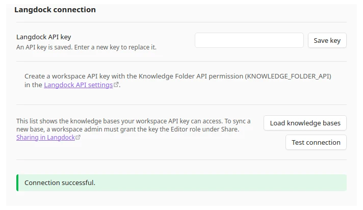
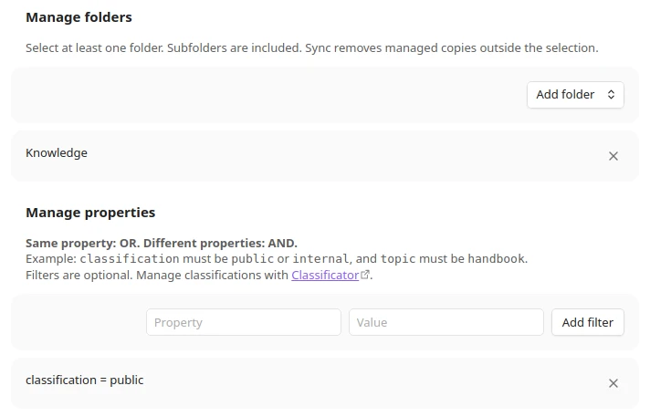
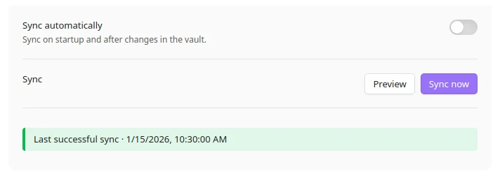

# Langdock Sync

[](https://github.com/nblum/obsidian-langdock-sync/actions/workflows/ci.yml)
[](https://github.com/nblum/obsidian-langdock-sync/releases/latest)
[](LICENSE)
[](https://github.com/nblum/obsidian-langdock-sync)
[](https://ko-fi.com/blumnico)

Send selected Markdown notes and attachments from Obsidian to a Langdock knowledge base. Choose which files to include, preview what will change, and sync manually or automatically.

Requires **Obsidian 1.12.4 or later** on desktop or mobile.

[Obsidian plugin directory](https://community.obsidian.md/plugins/langdock-sync) · [Get started](#get-started) · [Network use](#network-use) · [Filters and exclusions](#adjust-what-you-share) · [Troubleshooting](#troubleshooting)


## Network use

Langdock Sync requires a Langdock workspace and sends HTTPS requests to the Langdock Knowledge Folder API at `api.langdock.com`. It uses your workspace API key to list accessible knowledge bases, compare local files with copies in the selected knowledge base, and check indexing status. Sync uploads eligible files in full, including the YAML properties of Markdown notes, and removes managed copies when needed.

Opening an eligible file checks its sync status with Langdock when **Show sync button in files** is enabled. This option is on by default.

## Get started

### Install in Obsidian

1. In Obsidian, open **Settings → Community plugins**. Select **Turn on community plugins** if prompted.
2. Select **Browse**, search for **Langdock Sync**, then select **Install** and **Enable**.

### Connect to Langdock

1. Ask your Langdock workspace admin to create a workspace API key with the **Knowledge Folder API** permission (`KNOWLEDGE_FOLDER_API`). In the knowledge base’s **Share** dialog, the admin grants the key the **Editor** role. [Langdock setup guide](https://docs.langdock.com/en/developer/knowledge-folder-api/sharing)
2. In Obsidian, open **Settings → Langdock Sync**, paste the key, and select **Save key**.
3. Choose your **Knowledge base**, then select **Test connection**. Use **Load knowledge bases** to refresh the list if needed.



### Choose notes to sync

Under **Manage folders**, select **Add folder** and choose a vault folder, such as `Knowledge`. Subfolders are included. Choose **Entire vault (/)** to apply your filters across the vault.

The default filter includes notes with the property `classification: public`. To try it, create `Knowledge/Launch notes.md` and paste this example in Obsidian’s **Source mode**. If the note already has Properties, add the fields to that section.

```markdown
---
classification: public
audience: team
---

# Launch notes

The new help center is available to all customers.
```

The two valid classifications are `public` and `internal`. Each synced note needs a single classification, even if you remove all property filters.



### Include attachments

Under **Attachment extensions**, check the formats to include and select **Save extensions**. By default, every format is unchecked. Supported document formats include PDF, Word, PowerPoint, text, HTML, and JSON.

**Image files.** Langdock Sync skips images such as JPG, PNG, and SVG because the Knowledge Folder API rejects image uploads. To store images in Langdock, upload them manually under **Library → Folders**. Langdock's public API reference provides no upload endpoint for Library folders. [Knowledge Folder upload API](https://docs.langdock.com/en/developer/knowledge-folder-api/upload-file#supported-file-types) · [Library folder uploads](https://docs.langdock.com/en/using-langdock/library/folders#create-a-folder-and-add-files) · [Public API reference](https://docs.langdock.com/_llms/en/developer.txt)

Classify each attachment with Classificator. It records the exact filename and its classification under `attachment-classifications` in the `_meta.md` file of the attachment’s own folder.

```yaml
---
attachment-classifications:
  Product guide.pdf: public
---
```

The attachment must be in a selected folder and match the configured filters. Other property filters use the top-level properties in that same `_meta.md`. Set `langdock_sync: false` there to exclude that folder’s attachments.

### Preview and run your first sync

1. In **Settings → Langdock Sync**, select **Preview** to review planned uploads, updates, and deletions in Langdock.
2. Close the preview, select **Sync now**, and check **Last successful sync** in the settings. The example note will appear in your selected Langdock knowledge base.
3. To keep it up to date, turn on **Sync automatically**. This starts off disabled. Once enabled, it runs when you open the vault and after changes in it.
4. To sync periodically while the vault is open, choose a **Sync interval** of 15 minutes, 30 minutes, 1 hour, or 2 hours. It starts off disabled and requires **Sync automatically**.



### Sync an individual file

Eligible files show a sync button in their header when opened in an Obsidian file view. When Classificator displays a classification badge in the header, the sync button appears next to it. Purple means **Not synced**, yellow means **Outdated**, and blue means **Synced**. Select the button to view the status and the upload time of the indexed copy, when available. Select **Sync now** to sync that file. To hide the button, turn off **Show sync button in files** in **Settings → Langdock Sync**.

## Adjust what you share

- **Filter by more properties.** Under **Manage properties**, add `classification = internal` and `audience = team` alongside the default `classification = public` to include both public and internal notes for the team. Values for the same property are alternatives. Each different property must match. A list property matches when any item has an allowed value.
- **Exclude a file.** For a note, set `langdock_sync: false` in its Properties. For an attachment, remove its entry from `attachment-classifications` or give it a classification outside the sync selection. The next sync removes the managed copy from Langdock. Deleting a local file or changing the folder, extensions, or filters so it no longer qualifies also removes its managed copy. Files you uploaded separately remain in Langdock.
- **Use one source vault per knowledge base.** The plugin removes managed copies that fall outside the current vault’s sync selection.

## Troubleshooting

- **The knowledge base is missing or read-only.** Ask your workspace admin to check the key’s **Editor** access to that knowledge base. Then select **Load knowledge bases** again. [Langdock sharing guide](https://docs.langdock.com/en/developer/knowledge-folder-api/sharing)
- **A note is missing from the preview.** Check its folder, classification, and any extra filters. The preview lists changes, so an unchanged note that's already in Langdock may be absent.
- **Langdock reports an indexing error.** Check the message in **Settings → Langdock Sync** and select **Sync now** to retry.

[Report an issue](https://github.com/nblum/obsidian-langdock-sync/issues) · [Release notes](CHANGELOG.md) · [Local build and contributor guide](CONTRIBUTING.md#development)
