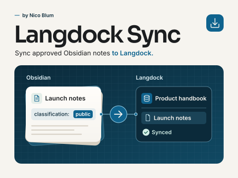
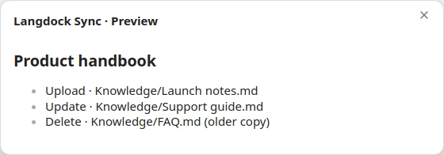

# Langdock Sync

Langdock Sync syncs approved Markdown notes from an Obsidian vault with a selected Langdock knowledge base. It uses files saved in the vault, including local notes that have never been committed to Git. Classificator and Langdock Sync are separate plugins that share the YAML property `classification`.



## Installation

1. Use Obsidian **1.12.4** or newer. Extract the build so that `main.js`, `manifest.json`, and `styles.css` are under `.obsidian/plugins/langdock-sync/` in the vault. Reload Obsidian and enable **Langdock Sync** under **Community plugins**.
2. In the Langdock API settings, create a workspace API key with the `KNOWLEDGE_FOLDER_API` scope and give it the **Editor** role in the knowledge base you want to sync. Enter the key under **Settings → Langdock Sync**. **Save key** stores it in Obsidian SecretStorage under the fixed ID `langdock-api`. [Langdock API settings](https://app.langdock.com/settings/workspace/products/api) · [Obsidian SecretStorage](https://docs.obsidian.md/plugins/guides/secret-storage) · [Langdock Knowledge Folder API](https://docs.langdock.com/en/developer/knowledge-folder-api/knowledge-folder-overview)
3. Load the knowledge bases, select the target, and click **Test connection**.
4. Select at least one folder under **Manage folders**. Review the **Preview** and click **Sync now**. **Sync automatically** starts off.

Langdock Sync follows the Obsidian language. You can override it below the plugin information at the top of the settings. Supported languages are German, English, French, Italian, Spanish, Dutch, Brazilian and European Portuguese, and Simplified Chinese. Other Obsidian languages use English.

The plugin shows a three-step introduction the first time you open it. **Show introduction** and **About Langdock Sync** are directly below the language selector. Both dialogs are also available from the command palette.

## Eligibility and sync

Selecting a folder includes its subfolders. **Entire vault (/)** includes the whole vault. Select at least one folder to sync. When a file no longer matches the selected folders or property filters, the next sync removes its managed copy.

YAML filters under **Manage properties** are optional. The default is `classification: public`. Multiple values for one property are alternatives. Different properties must all match. For a YAML list, one matching item is enough. You can manage classifications with [Obsidian Classificator](https://github.com/nblum/obsidian-classificator).

Every eligible note must have exactly one `classification` value in its YAML frontmatter, either `public` or `internal`. The plugin skips notes with `langdock_sync: false`, missing or invalid classifications, `_meta.md`, and hidden paths. It uploads the full contents of each eligible Markdown file, including frontmatter.

Automatic sync runs when the vault opens and groups rapid changes. The plugin compares content hashes to identify unchanged files. After a change, the previous version stays available in Langdock until the new version reaches `SYNCED`. If a note loses approval or is deleted, the plugin finds and removes its managed copy using the naming scheme. Renaming a note changes its path hash. The preview shows the old copy for deletion and the new path for upload.

The plugin settings show sync status and errors. Automatic sync retries temporary connection failures. If Langdock reports an indexing failure, use **Sync now** to retry indexing the same content.



Additional screenshots show the introduction, connection settings, filters, and sync status. [All screenshots](assets/screenshots/)

## Switching from the GitHub workflow

1. Use the same vault and knowledge base as the existing workflow. Disable the **Langdock-Wissensdatenbank aktualisieren** workflow in GitHub Actions (`.github/workflows/sync-langdock.yml`) and wait for any running jobs to finish.
2. Keep automatic plugin sync off at first. Select the folders you want to include and review the preview for the existing target. The plugin recognizes uploads from the Python script by their path and content hashes and reuses them if the contents are unchanged.
3. Run the first sync manually. Enable automatic sync on the device that will maintain this knowledge base. Use one automatic sync per knowledge base.

Managed filenames start with the readable note title. Langdock Sync reserves the suffix `--obsidian-nblum-<path-hash>-<content-hash>.md` for managed uploads. Manually uploaded files with regular names remain in the knowledge base.

## Build locally

Use the Node.js version pinned in `.nvmrc` to build `main.js`.

```sh
nvm install
npm ci
npm run build
```

See [CONTRIBUTING.md](CONTRIBUTING.md) for development commands and tests.
